<p align="center">
  <picture>
    <source media="(prefers-color-scheme: dark)" srcset="docs/brand/openvibes-wordmark-dark.svg">
    
  </picture>
</p>

<h3 align="center">OpenVIBES Agent</h3>

<p align="center">
  The small, read-only agent of <a href="https://github.com/openvibes-project">OpenVIBES</a>, a free, self-hosted security
  tool for homelabs and small businesses. It looks at a host, checks it
  against signed rules and reports to your platform. It never changes the host.
</p>

<p align="center">
  <a href="https://openvibes-project.github.io/">Install</a> ·
  <a href="docs/capabilities.md">What it does in detail</a> ·
  <a href="docs/configuration.md">Configuration</a>
</p>

## What it does

- **Collects facts:** installed packages, running programs, listening ports
  and the services behind them, hardening settings and the operating system.
  It reads files and system interfaces; it never runs a shell or a program.
- **Checks signed rules** against those facts: risky exposure, compliance and
  hardening. Rules are signed offline and run in a small, sandboxed
  expression language.
- **Raises threat alarms** from program starts within seconds (eBPF, or the
  kernel audit system as a fallback).
- **Reports to the platform** over mutual TLS 1.3, with a local queue so
  nothing is lost while the platform is out of reach.
- **Works without a platform:** with no network at all, it exports its
  results to files you carry over.
- **Stays light and unprivileged:** one Rust binary under its own user;
  only a tiny helper reads what needs root.

## Install

Packages for **Fedora 44, AlmaLinux and Rocky Linux 9+, Debian 12+,
Ubuntu 22.04+ and Arch** (x86_64), and an **MSI for Windows 10, 11 and
Server 2016 to 2025** (preview). The easiest way is the platform console:
Settings › Enrollment gives you an install command or package with
everything filled in. By hand: `install.sh` on
[openvibes-project.github.io](https://openvibes-project.github.io/), or the
[latest release](https://github.com/openvibes-project/openvibes-agent/releases/latest).
Windows: [`docs/install-windows.md`](docs/install-windows.md).

After installing, `openvibes-test alarm` makes the host raise a harmless test
alarm, so you can see the whole path work.

## Build and test

```sh
git clone --recurse-submodules https://github.com/openvibes-project/openvibes-agent.git
cd openvibes-agent
cargo clippy --locked --workspace --all-targets --all-features -- -D warnings -F unsafe-code
cargo test --locked --workspace --all-features
```

CI runs these on Linux, Windows and macOS, plus a RustSec audit
([`workflow.md`](workflow.md)).

## Documentation

- [`docs/capabilities.md`](docs/capabilities.md): every collector, rule and
  safety measure in detail, and what is planned.
- [`docs/configuration.md`](docs/configuration.md): the settings file, local-only mode and exports.
- [`design.md`](design.md) and [`security.md`](security.md): architecture,
  trust boundaries and the security rules every change keeps.
- [`docs/components/`](docs/components/): one page per crate.
- [`docs/dependencies.md`](docs/dependencies.md): what the packages ship, with versions and licences.
- [OpenVIBES Protocol](https://github.com/openvibes-project/openvibes-protocol):
  what the agent and the platform send each other.

## Contributing

Issues and pull requests are welcome; see [`CONTRIBUTING.md`](CONTRIBUTING.md).
Security problems: please use private vulnerability reporting, not a public
issue.

**AI disclosure:** OpenVIBES is built with the help of AI coding tools
(Claude Code and Codex). Every change goes through a pull request and the
full CI before it is merged.

Licensed under the [Apache License 2.0](LICENSE).
